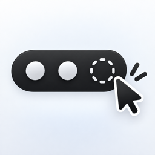

# ClickBar



A small menu bar organizer for macOS 27. Group apps behind a three-dot control and open their icons in a panel below the menu bar.

## Features

- Assign apps to **Always visible**, **Single click**, or **Double click**.
- Single-click the three dots to open the first group; double-click to open both hidden groups.
- Hidden groups stay hidden on the main menu bar while the lower panel is open.
- Open supported apps’ menu bar menus from the lower panel with Accessibility access.
- Open BetterDisplay’s native controls through its documented integration command.
- Store preferences locally. Checking for updates contacts GitHub only when requested. No account or screen capture is needed.

## Requirements

- Apple Silicon Mac
- macOS 27 or later
- To build: Swift 6 and the macOS 27 SDK, available with compatible Xcode Command Line Tools

## Install

Download `ClickBar-v0.2.3-macOS-arm64.zip` from the [release](../../releases/tag/v0.2.3), extract it, and move **ClickBar.app** into **Applications**. Quit other menu bar managers, open ClickBar, choose your groups, and enable hiding.

Allow ClickBar under **System Settings → Privacy & Security → Device Control and Data Access** (called Accessibility on earlier macOS) to open other apps’ menus. Return to ClickBar and use **Check Access**.

The current downloadable build is locally ad-hoc signed and is not Apple Developer ID notarized. macOS may require explicit approval to open a downloaded copy. Building from source is also supported.

## Build and check

```sh
chmod +x build.sh
./build.sh
swift run -c release ClickBarTests
```

The app is created at `dist/ClickBar.app`. Move that copy into Applications before launching it. The checks use a plain executable target, so run the command above rather than `swift test`.

## Notes and limitations

- Grouping applies per app, including all status items owned by that app, and is shared across displays.
- The lower panel uses application icons rather than captured live menu bar glyphs.
- Apps without accessible menu bar items can appear in the settings list. Some custom popovers need app-specific support.
- BetterDisplay’s CLI access must be enabled in its Application → Integration settings. ClickBar does not change its display controls or integration preferences.
- Hiding uses the private macOS 27 MenuBarClientCore framework. Future macOS versions may change it.
- A rebuilt ad-hoc-signed executable can invalidate its previous Accessibility approval. If the switch is on but ClickBar reports no access, remove the stale ClickBar entry and add the currently installed copy again.
- Launch at login is optional and can be controlled in ClickBar settings.

## Credits and licensing

The private-framework shim is adapted from [Stash](https://github.com/brentc22/stash), copyright 2026 Brent Ceulemans, under MIT. Accessibility menu mirroring follows [SmartHiddenBar](https://github.com/roypadina/SmartHiddenBar), copyright 2026 Roy Padina, under MIT. Its notices also credit Hidden Bar, copyright 2019 Dwarves Foundation.

Full upstream license notices are included in `Resources/Stash-LICENSE.txt` and `Resources/SmartHiddenBar-LICENSE.txt`, and copied into built app bundles.

ClickBar is available under the [MIT License](LICENSE). The upstream license notices must remain included. The app icon was generated with ChatGPT.
